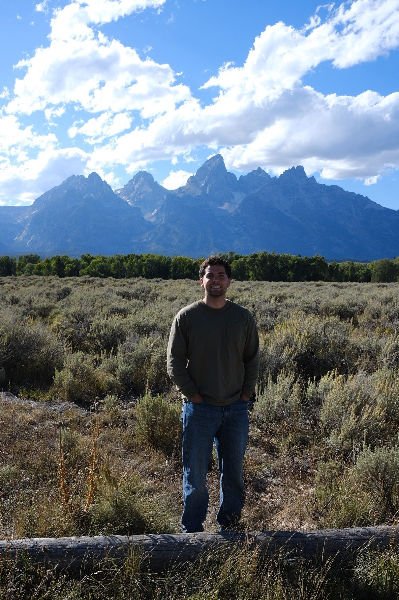
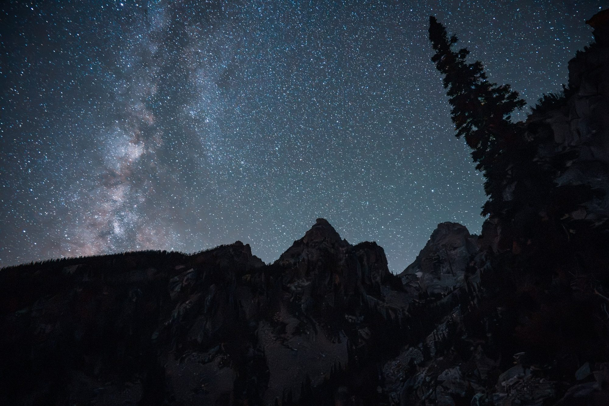
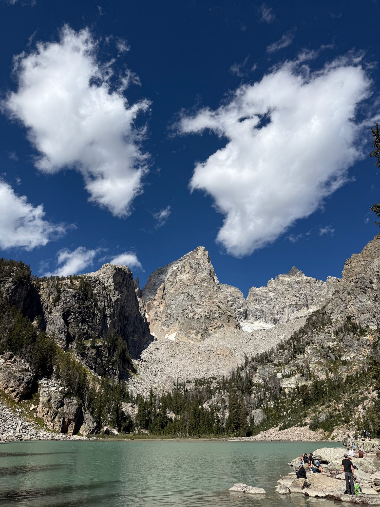
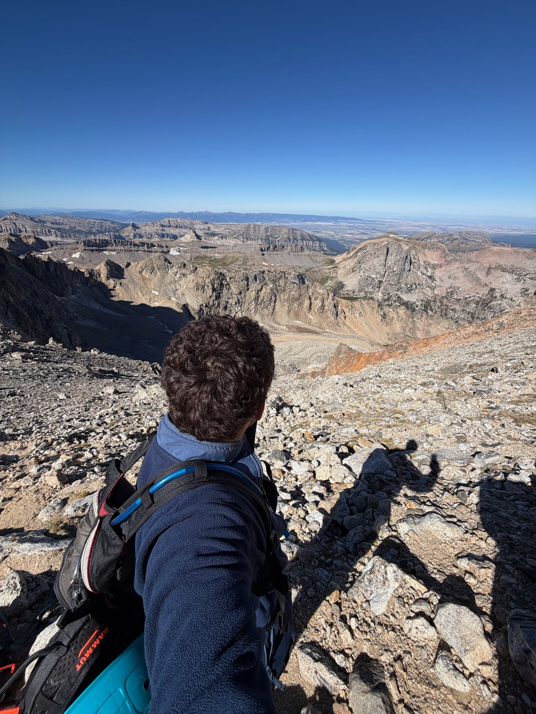
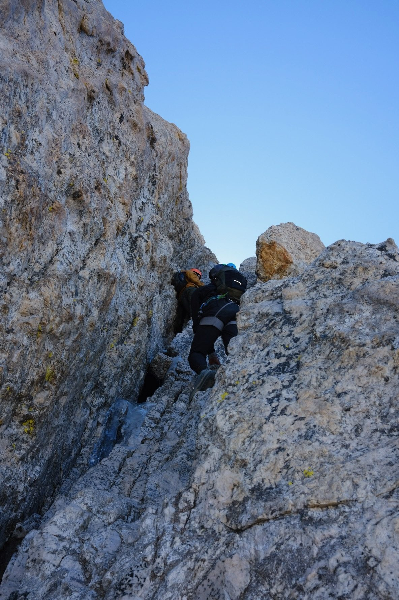
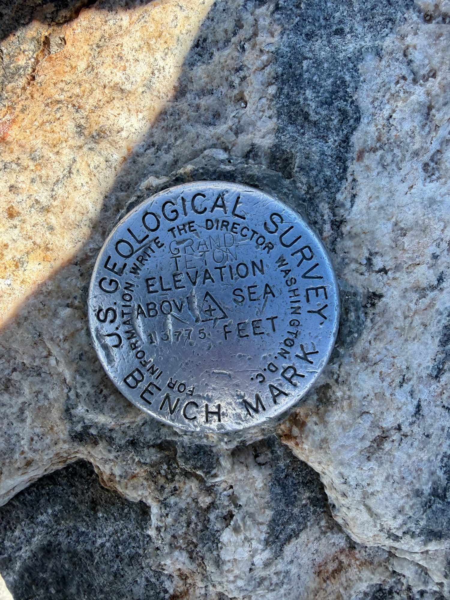
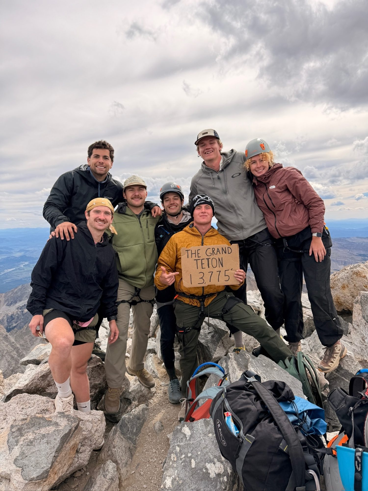
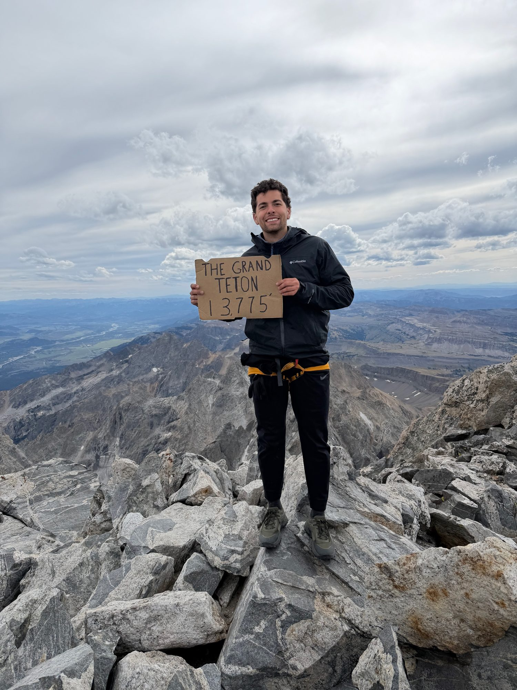
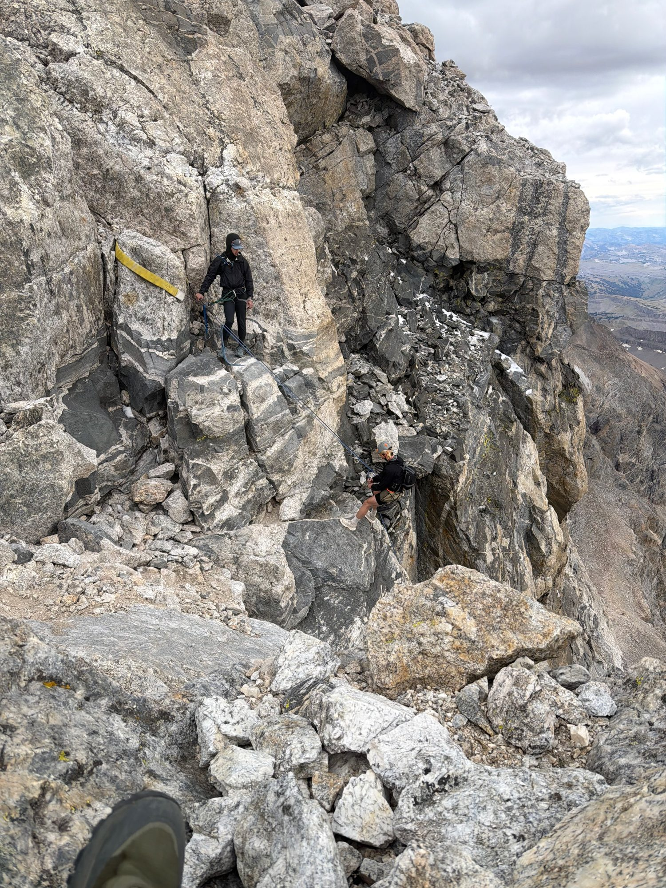

Last summer, a few friends and I did a road trip through Glacier, Yellowstone and Grand Teton National Park, backpacking along the way. That was the first time I'd ever seen the Teton Range. The Grand is one of those mountains you already know before you've seen it (it's even on a Kanye album cover), and seeing it in person made me want to climb it. From then on it was a goal: find my way up there.

It came up again and again in our friend group over the next year, and this September we finally made the plans and followed through.

*The Grand, from the valley floor.*

## Getting there

We all met at a dispersed campsite at Shadow Mountain, just outside the park, rolling in late Friday night. Saturday was the warm-up: we hiked to Delta Lake, where the water was absolutely frigid, then took a dip in Jenny Lake on the way back. That evening we went into Jackson Hole for burgers and pool at the Cowboy Bar, then turned in early to get some sleep before the big day.

*Friday night, after we rolled in.*

*Delta Lake, the Saturday warm-up. The Grand is the peak right above it.*

## Going in

A couple of weeks earlier I'd done Half Dome in Yosemite: a long day, a lot of elevation, and an exposed section that was, quote unquote, scarier. So I felt ready. But the more I learned about the Owen-Spalding route, especially the Belly Roll, the more nervous I got. What helped was my shoes. I'd been wearing my Columbia Tellurix Titanium OutDry shoes, and they'd gripped so well on other hikes that I trusted them completely.

We almost called the whole thing off. One weather report showed really high winds, so we checked with the rangers. They said it was still good to go and they weren't turning anyone around. So we committed.

None of us was a guide, but one of our group had real rock climbing experience, and they brought rappel gear and knew how to get us all down safely.

## The approach

Sunday morning we packed our bags and set off in the dark. We got going later than planned, around 6 a.m., so it was light after a couple of hours. Hiking in the dark always makes the miles go by faster, and we made great time: we reached the Lower Saddle, about six miles and 5,000 feet in, in just under three hours. We were feeling really good.

Then we checked the AllTrails map. We still had about 2,000 feet to climb over 0.8 miles. After everything we'd already done, the rest looked straight up.

*Above the Lower Saddle, looking back the way we came.*

## The climb

The technical climbing starts at the Upper Saddle, and Owen-Spalding opens with the Belly Roll. Right after it comes the Crawl. Neither section is a hard move, but both are very exposed, so the best advice is not to look down.

After the Crawl came the Double Chimney: again not too bad, but very exposed, and the consequences of a fall felt severe. Then the Owen Chimney, which had some ice in it, so we had to be very careful about where we stepped. It was manageable. Sargent's Chimney felt far less exposed and much more doable, and after that it was just a scramble to the top.

*Into the chimneys.*

## The top

I summited a little before 3 p.m. The weather was awesome and the views were incredible. I was overtaken by a sense of beauty and accomplishment, and probably a lot of adrenaline from the climbing. It was unparalleled. At the same time, it finally sank in that I'd just free soloed everything I'd climbed to get there. There was a lot of emotion at the top, all at once.

*13,775 feet.*

The rest of the group made it up about half an hour later. We hung out, took our pictures, and started down.

*The whole crew.*

## Getting down

Instead of downclimbing the chimneys and undoing all of that, we used the rappel gear. There's a rappel point below Sargent's Chimney that drops you back to the Upper Saddle, and after a day of scrambling it was a fun switch-up. From the Upper Saddle we hiked down to the Lower Saddle, and by then it was getting dark. The rest of the hike out was in the dark, but it was fairly easy. We got back to the cars around 11 p.m.

*The rappel: much better than downclimbing.*

It was a full day, one of the hardest things I've ever done physically, and completely worth it with a fun group of people.

## If you're thinking about it

- **Start earlier than 6 a.m.** We had a long walk out in the dark because of it.
- **Bring rappel gear**, and someone who knows how to use it. Unless you're a serious climber, don't try to downclimb, especially with ice in the chimneys.
- **Check with the rangers** if the forecast looks bad. One scary weather report almost talked us out of a perfect day.

Would I go back? Not for a while. Next time I'm in the Tetons I'd rather summit the Middle Teton or another peak I haven't done. The exception is if friends who haven't done the Grand want to go, because then my experience could be of use.
